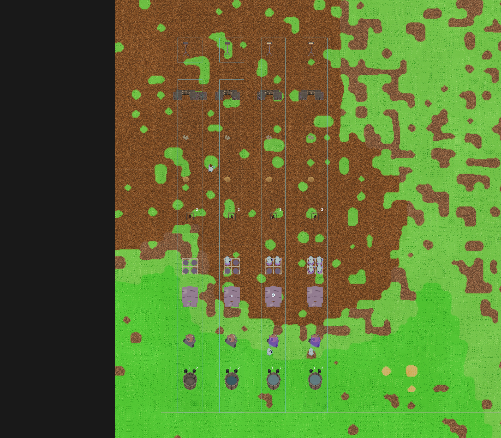
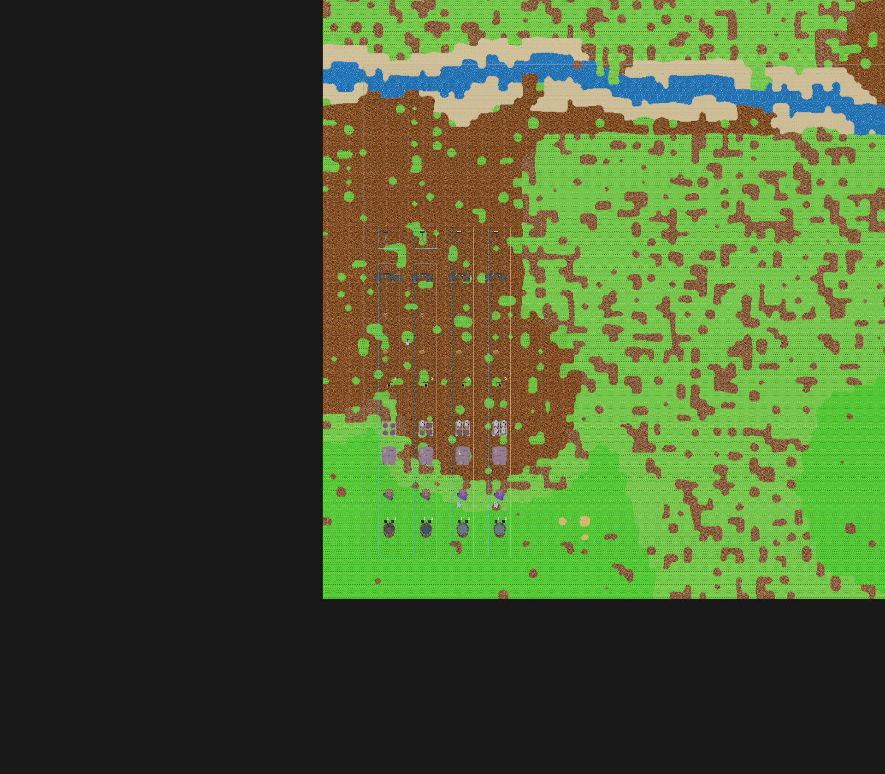
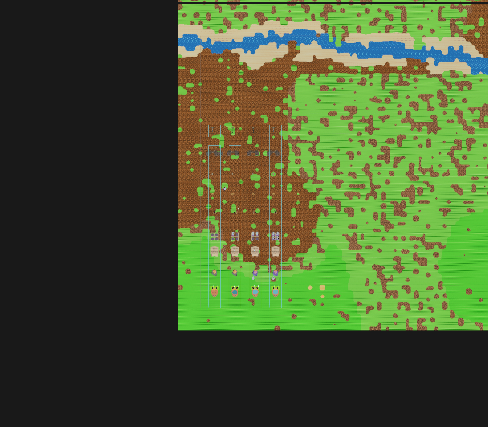
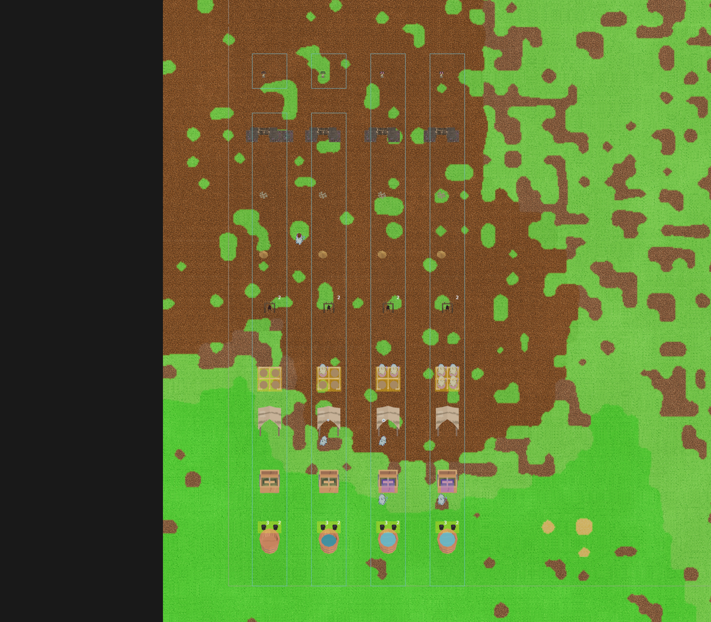

# 建築物のモデリング・テクスチャ制作仕様

本書は仮設設備・生産設備を中心とする建築物の制作方針を定義する。
世界観は [world_lore.md](world_lore.md)、既存asset固有の寸法・受入条件は
[art-style-criteria.md](art-style-criteria.md)、原本・export・releaseの運用は
[assets_workflow.md](assets_workflow.md) を参照する。
本書の定義は新規制作の基準であり、個別モデルの実装済み・目視受入済みを意味しない。

2026-11-15の5設備は、以下の役割分担を新しい正式assetへ接続した。
Tankは手描きの色面をbodyへ投影し、動くMixerとM3設備は元UVに沿う描線を部品へ固定する。
world-up diffuseを使い、元geometryはdepth・遮蔽・影biasを担当する。実emission・alpha・post処理は維持する。
Lampは2Dのまま、面別ハイライトを抑えた塗装と高いポール・三脚を使う。
個別art/numeric/release採否と導入は[現行世代](building-asset-sets.md#2026-11-15-ミキサーと休憩所の判読性改訂)を正本とし、
導入後の9種画面は本書、静止性能は[性能仕様](rendering-performance.md#面塗り方式の9種の静止asset増分受入2026-11-15)を参照する。
以下の過去の画像・結果はそれぞれの日付の履歴である。

2026-11-15の追加フィードバックで、利用者はMixerの現行アートを不採用、RestAreaを判読困難と評価した。
配色だけの案は採用せず、長いドラム・架台・車輪を分けたMixerと、棟・支柱・閉じた入口が読めるRestへ改訂した。
両g5は新しい独立art/numeric/release審査と復元試験を通過し、正式導入した。
MixerはDirt上の実モデルの車輪・架台を追加比較し、下段のdescriptor画像と混同しない。
Restは入所Soulを描かない閉鎖shellのまま、急な布テント断面を使う。
[判読性修正計画](plans/mixer-rest-readability-plan-2026-11-15.md)で導入後の9種画像と性能を確認中。
以下の既存画像は旧世代の履歴であり、新しいinstalled subjectの受入を代用しない。

## 1. 目指す画面

**用途と組み立て方が分かる立体を、手描きの線と大きな色面で描く。**

プレイヤーは建設現場を俯瞰し、施設・作業員・資材の関係を読む。
建物の外形、容器の深さ、支柱の前後、可動部は、その理解に必要な立体情報である。
Rough Vector Sketchは、それらを少し歪んだ輪郭、整理した面、描き込んだ材質で見せる。
最終画面では、用途を示す輪郭と大きな色面が先に読める、平面的な挿絵として成立させる。
立体の陰影は構造を読むのに必要な範囲へ抑え、滑らかな明暗の連続や光沢を画風の主役にしない。
精密な表面凹凸、細かな光沢、密集した装飾より、通常のゲーム画面での判読を優先する。

地獄らしさは黒ずんだ木、風化した骨、錆鉄、補修された布、必要な箇所の紫の光に持たせる。
怠惰なSoulが働く世界として、手作業の不揃いさや継ぎはぎを許す。ただし支柱の支持先、
容器の開口、作業位置、搬入先が分かる構造を保つ。歪みを全体へ均等なノイズとして加えない。

画面の情報は次の順に読む構成とする。

1. 外形と大きな色面で、建物の種類と占有位置が分かる。
2. 開口・作業部・状態差で、使い方と現在の稼働が分かる。
3. 近づくと、木目・継ぎ目・筆跡から素材と世界観が分かる。

## 2. 表現の役割分担

| 層 | 担当する情報 | 制作上の境界 |
| --- | --- | --- |
| モデル | 外形、厚み、開口、奥行き、部品の前後、動く部位 | シルエット・depth・動きに影響する部分を作る |
| 色テクスチャ（albedo） | 材料色、部材境界の線、木目、錆、縫い目、筆跡、弱い接合部の暗さ | 面に属する模様を描く。背景まで抜ける穴や動く部品を絵だけで代用しない |
| UV | どの面に、どの向き・大きさで模様を置くか | モデルの構造と描画内容を対応させる |
| マテリアル・照明 | 世界に置かれた物としての面の明暗、落ち影、既存の室内光への応答 | 形を読む補助に使い、素材の識別を細かな反射へ依存させない |
| 状態表示 | 水位、回転、開閉、稼働箇所、点灯 | 実際の状態を読む。固定の汚れや装飾と区別する |

部品を立体化するか迷ったときは、以下のどれかを満たせばモデルにする。

- ゲームの視点から見える外形が変わる。
- 後ろの物が見える／隠れる関係が変わる。
- 独立して動く、または状態によって高さ・位置が変わる。
- 用途を読むために必要な、太い縁・支柱・開口・段差を作る。

それ以外の細かな溝、傷、小さな留め具、板の継ぎ目は原則としてテクスチャに置く。
微小で通常表示時に消える情報は、描画する前に省略を検討する。

## 3. モデリングの基準

### 大きな形と小さな歪み

桶、槽、架台、庇など、機能を説明する少数の大きな形から作る。
縁の高さの不揃い、支柱の軽い曲がり、布のたわみを、形の特徴が残る範囲で加える。
論理占有、接続port、設置anchor、作業・通行条件は個別建物の契約を優先する。
見た目の穴はRoomやLight Fieldの通光条件を変更しない。

ポリゴン数は外形と必要な凹部を保つために使う。木目一本、縫い目一針、錆の粒は立体化しない。
一方、桶の内側や架台の下の空間は実際の形で作り、黒く塗った平面を開口の代わりにしない。
裏面・底面は通常視点、許可された向き、動作中の見え方と影を確認してから簡略化する。

### 面の陰影

少ないポリゴン数と、三角形ごとに明暗が割れる外見は別に扱う。
丸い槽の側面は意図しない細かな陰影段差を抑え、縁・板の角・金具の折れは面を分けて読む。
法線はこの面構成に合わせる。全てをflat shading／smooth shadingの一方へ揃えない。
微小な面取りを大量に追加してハイライトを作ることは、初期設備セットの制作方法に含めない。

### 可動部

原本では固定部と可動部、水面などの状態部を分け、軸・可動範囲・接合部を決める。
固定の架台や容器まで回転させて稼働を表現しない。可動部の裏側と回転後の線の見え方も制作対象にする。
このauthoring上の分離は、multi-node GLBがそのままruntimeへ読み込めるという契約ではない。
個別導入時に部品別meshか状態別meshかを決め、共有handle・loader・状態consumerを接続する。
壁・扉の単一meshやtriangle上限を、用途の異なる全設備へ機械的に適用しない。

## 4. テクスチャとUVの基準

### 線と色面

まず素材ごとの基調色と、少数の明部・暗部を置く。筆跡はそれらの面に低いコントラストで重ねる。
明暗を少数へ整理するのは描画内容の方針であり、全画面を段階化する新しいshaderの要求ではない。

強い線は、縁・主要な接合部・用途を読む境界へ選択して置く。
内部の木目や縫い目は、それより細く弱くする。全ての板・石・UV islandを黒い枠で囲わない。
線のゆらぎは静的な形や筆致として持たせ、毎フレームのランダム変形は行わない。
最遠表示で内部線が潰れることは許容するが、黒い塊になって素材の色面や設備の外形を消してはならない。

texture-baked lineworkは面に描く線であり、任意の姿勢の外周へ一定幅の線を発生させる機構ではない。
外形の読みやすさはモデルの輪郭と背景との明暗差で成立させる。新しい輪郭rendererを前提にしない。
線幅は元画像のpixel数だけで決めず、最終compositeの通常表示とズームアウトで判断する。

現行Wallの大きな石面・弱い目地・低コントラストの断面は、この情報整理の参照例とする。
古い参照画像にある密な留め具、全面の黒枠、紫の裂け目を、全設備共通の必須装飾にはしない。

### 材料ごとの描き分け

| 材料 | モデルに持たせる特徴 | テクスチャに持たせる特徴 |
| --- | --- | --- |
| 木 | 板・支柱・縁の大きな歪み、必要な隙間 | 材の長手方向に沿う少数の木目、黒ずみ、擦れ |
| 骨 | 太い節、曲がり、骨らしい外形 | くすんだ骨色、弱い筋、欠けの描線 |
| 錆鉄 | 帯・支え・大きな折れや突起 | 低彩度の鉄色、広い錆斑、少量の縁の擦れ |
| 布 | 屋根・庇の輪郭と大きなたわみ | 継ぎはぎ、太さを整理した縫い目、大きな皺 |
| 石 | 構造の厚み、開口、外形を変える大きな欠け | 大きな石面、弱い目地、断面用の別模様 |
| 水・泥 | 容器と別の表面、高さ・露出範囲 | 濁った色、少数の波紋・流れの筆跡 |

金属もマットな塗りを基本にする。水・泥は初期仕様では不透明な色面として扱い、
透明度・屈折・鏡面反射を、液体と分かるための必須条件にしない。
骨色や明るい縁は施設内の識別に使い、発光していない施設全体がSoulや選択表示より目立たないようにする。

### UVと画像の作り方

- 側面、上面、断面、内側を意味のある面として展開する。Tankの明示投影方式を除き、正面用の完成イラストを箱全体へ投影しない。
- 木目は部材の長手方向へ、断面は断面へ割り当てる。上面へ側面の板列や石積みを引き伸ばさない。
- 同じ素材・同じ役割の面はtexel密度をそろえる。細長い面への圧縮で線だけが極端に太くなる配置を避ける。
- 同じ模様の共有は許すが、ミラーで木目・文字・状態表示の意味が変わる面は分ける。
- UV境界にはfilter用の余白を用意し、縮小表示で別素材の色や黒線が流れ込まないことを確認する。
- 画像生成を使う場合も、素材面の絵と建物の完成図を分ける。albedo素材にはカメラ遠近、背景、落ち影、光沢を描き込ませない。

M3のSoulSpa骨shaftは長辺で共通正規化した細いUV quadを持つ。描線はatlas cellの固定座標ではなく、
実quadの両端edgeを補間した長軸内側へ置き、polygon mask後にも上向き各面へ残ることを画素回帰で確認する。
これは描線の到達性だけの保証であり、通常縮尺で骨として読めることや美術採用はfresh実機画像で別途判断する。
骨の形状・色・slot配置・emissiveやgameplay契約はこの補正で変えない。

解像度は実際の表示面積とatlas内の配分から決める。高解像度画像であること自体を品質基準にしない。
同種assetで模様の大きさをそろえ、拡大原図より縮小後の色面と線の残り方を優先する。

## 面塗り方式と採用画面（2026-11-15）

照明係数だけを変える方式は、通常・遠景の実機比較で厚い縁や屋根の立体感を十分に抑えられず不採用とした。
その仮説を打ち切り、画面で読む色面・描線と、geometryが担当する深度・遮蔽を分離した。

- **Tank**: `body_paint_projection/world_preview_v1`から手描きpaintをbody専用のmode3材質へ投影する。
  元GLB・UV・部品を保持し、透明previewとbodyのopaque matte合成を使い分ける。
  canvas/anchorはpreviewから導出し、RtTの縦補正は一度だけ行う。
  waterは別材質で旧0.82混合と実水位12/22WUを保ち、Empty/Partial/Fullを区別する。
- **MudMixer**: `surface_paint/uv_ink_v1`のmode4で元UVへobject-localな継ぎ目・傷・摩耗印を固定する。
  傾斜ドラムが回る際も描線が部品と一緒に動き、固定架台へ完成図を投影しない。
  local Y回転・pivot・pause/load/moveの既存契約を保つ。
- **RestArea / SoulSpa**: mode4のUV描線を使う。布の縫目、骨の長軸に沿う筋をgutterまで連続に描き、
  面法線由来の陰やtriangleごとの黒枠を焼き込まない。Restの閉じた小屋と入所Soul非表示、
  Spaの四区画・実worker-slotだけの発光を保つ。黄色いGeneratePower重ね表示は使わない。
- **OutdoorLamp**: Foreground2dを維持する。高いポール・三脚・頂部投光器を、面別ハイライトを抑えた
  煤けた灰紫の塗装で読む。初案はDirt上で脚が埋もれたため不採用とし、既存alpha内の塗装線で連続した輪郭を回復した。
  off/onの状態差・alpha・anchor・配電・論理光の契約は保持する。

mode3/4のdiffuse参照はworld-upへ固定する。実geometryのnormalはdepth・遮蔽・shadow biasに残し、
emission・alpha・post処理を一度だけ適用する。全画面のposterize、輪郭用の追加renderer、設備専用光源は加えない。
この方式はmaterial uniformと実image/mesh/poseの結合を観測でき、単なる画像の差替え確認で終えない。
新原本にはpaint/mask/設定/recipeを含め、元GLB/UV・旧authorityを上書きしない。

clean `19e608ace4c34169b4e7a1f8c00c1213ad256b3b`の通常既定bindingで、High/DPI1・normal/far各36 ownerを確認した。
owned X11/Vulkanの原画像であり、9種とWall/Floor/Soul/携行iconの混在、Tank body mode3、水面の分離、
Mixer/Rest/Spaのmode4、実maskに応じた発光とresident handleを独立確認した。
この画面はseeded静止galleryであり、自然施工・active AI性能の画像ではない。
個別のart/numeric/release判断、通常入力の利用・保存読込、静止性能は別々の証拠で判断する。

原画像SHA-256はnormal `a48607d386842672be289804d9e33e05ba3bc85f242141905b02ab0a846b63a3`、
far `e4021d2cd3a1f5c1ace3ec8b07bba14d4b30e156da8a18303a928f7c726b2358`。
gallery manifestは`e2c260daae222317cbe1dae69692f354c235ae5567c801dc55872beaa54897ad`。
過去の照明試作画像や未採用のTank原画は比較履歴であり、現行releaseや新たな承認を意味しない。

## 5. 光・陰・発光の分担

albedoに許す陰は、板の継ぎ目や固定接合部の弱い暗さなど、物に付随する局所的なものに限る。
強い方向光、周囲への落ち影、動く部品の影、広い白いハイライトは焼き込まない。
向きや状態が変わっても残る固定の影は、ゲーム側の陰影と二重になりやすいためである。

新規の構造3D設備は既存のlit経路を使い、現在の共有材質と同じマットな設定を制作基準とする。
roughness=1、metallic=0、reflectance=0を起点とし、Blenderの確認用材質も反射を無効にする。
これらは新しいレンダリング方式の提案ではなく、ゲームと原本の見え方をそろえる条件である。
初期設備セットはalbedoを必須とし、normal・height・独立AO・metallic/roughnessの画像は使用しない。
発光が必要な設備だけ、意味のある部位にemissiveを追加する。

室内光の表示・遮光は既存のLight Field契約に従う。家具の穴・大屋根・emissiveを追加しても、
新しい遮光体や論理光源が自動で増えるとは扱わない。emissiveは発光面の見え方を担当し、
周辺を照らすことやLampのgameplay効果とは別に接続・確認する。
材質ごとの明るさ調整で足りる問題に、asset専用の光源を足さない。

## 6. この分担を使う例

以下は表現方法の例であり、個別設備の最終意匠・新しいgameplay仕様の確定ではない。

| 対象 | モデル | テクスチャ | 状態・照明 |
| --- | --- | --- | --- |
| タンク | 歪んだ桶、厚い縁、内壁、独立した水面 | 木目、鉄帯の錆、弱い継ぎ目、水面の筆跡 | 水位を既存の空／途中／満杯と対応させる。桶の影は照明に任せる |
| ミキサー | 建設現場用の傾斜した回転ドラム、架台、車輪 | 錆鉄の広い色面、主要な接合線 | 実精製中だけドラムが動く。予約・搬入中は稼働と見なさない |
| 休憩所 | 内部を覆う屋根と布壁、支柱、入口のカーテン | 継ぎはぎ、縫い目、少数の皺 | 入所者を表示しない。既存のDream表示を維持し、布へ利用中の光を固定で描かない |
| Soul Spa | 4区画を読める低い骨の構造 | 骨の筋、紋様、区画の境界 | 設定上限ではなく実稼働区画へ発光を対応させる |

2D小物も外形・部材・筆跡の情報階層を共有する。2D画像には最終的な陰影を描けるが、
3Dのalbedoへその画像をそのまま転用しない。媒体をまたいでそろえるのは線・色面・素材の読み方である。
現在の3D／2D分類と、論理占有・通行・Roomの仕様はこの制作定義では変更しない。

## 7. 制作順と採否判断

1. **構造ラフ**: 役割、占有・作業位置、外形、開口、可動部を決める。
2. **無地モデル**: ゲームと同じ59°正射影・軸方向・RtT縦補正の画面で、形と重なりを確認する。
3. **素材の色分け**: 木・骨・鉄などを大きな色面で置き、白黒表示でも主要部が分かれるかを見る。
4. **UV・描線**: 面の意味と模様の向きを合わせ、用途に必要な線から描く。傷や筆跡は最後に足す。
5. **材質・状態の接続**: ゲーム内の照明と実状態で確認する。同じ原本から設計図・配置previewを作り、投影・anchorを合わせる。
6. **最終画面で比較**: 通常zoom、最大zoom-out、近景、明暗の異なる場所、壁・Soulとの前後、全状態と停止中の表示を確認する。

次の全てを満たすことを採用条件とする。

- 無地でも、槽・架台・屋根・区画などの主要構造と、類似設備との形の違いが読める。
- 通常表示で種類・作業部・主要な状態差が分かる。重要な状態差が最遠で消える場合は、既存UI等の確認経路も含めて個別に決める。
- テクスチャ追加後に、用途を説明する形が線や模様に埋もれない。
- 木・骨・鉄・布が反射なしでも描き分けられ、壁やSoulと同じ画面に置いて画風がそろう。
- 開口が実際のdepthと一致し、主要な線・影・模様が許可された向きや動作中に破綻しない。
- 低品質・縮小時にも外形と大きな色面が残り、ちらつく細線や隣接設備との黒い塊にならない。
- 完成表示と配置previewで形・縮尺・接地位置が対応し、稼働表示は実際の状態を反映する。

無地で主要構造が読めない場合は形状を、模様追加後に読めなくなる場合はUV・線の密度を、
照明を入れて潰れる場合は焼き込んだ陰と材質・光の整合を見直す。
Blender上の見栄えだけを最終合格とせず、個別導入時のゲーム内受入は既定のnative acceptance手順に従う。

### RestAreaの限定art-context比較

`scripts/building_art_acceptance.py --variant rest-area-art-context --view near|normal|far`
はArtPreviewのRestAreaだけを扱う明示profiling場面であり、既定の36体galleryやM6とは別契約である。
既存factoryで完成させた4体（利用者0/1/5/0）、占有footprint外の上下各1壁、同descriptorを
通常previewと同じhandle/canvas/Anchor適用関数へ渡した4画像を一度だけ配置する。
previewの基準点は完成ownerからworld Y=-160に並置し、実Camera2d・RtT target・縦補正済み
compositeの完成接地点と既知offsetを照合する。輪郭や縮尺の美術採否は撮影後の独立判断を要する。

`--lighting standard|dim` は既存PBR Ambientのbrightness 500/100と主Directionalの
illuminance 12000/2400を比較し、追加Directionalは0/影なしのままとする。実光源・影・材質・
camera/layers・壁depth・画像role/hash・Anchor/custom_sizeとresident inventoryを観測し、
readiness後の変化は補正せず拒否する。通常起動、通常入力ghost、既存LightField実装は変更しない。
証拠scopeは `seeded-paused-art-comparison`、accepted/performance/promotion=false。
この場面の技術passだけでは通常照明環境全体、通常利用/lifecycle、独立art/numeric、releaseを承認しない。

### SoulSpaの全16区画mask検査

同helperの `--mode candidate --kind SoulSpa --spa-mask-page 0|1|2|3` は、独立art/numeric決定を
持つisolated_candidateだけの明示small galleryである。standard照明とnear/normal/farを使い、
4標本へmask `[4p,4p+1,4p+2,4p+3]` を一度だけseedする。他種の8人にmaskのpopcountを加えた
12/16/16/20人を要求し、未指定のgallery（mask 0/1/3/15・15人）やM6・通常起動を変更しない。
実tileのworkersから計算したmask、消費されたexact世代、body/slot0〜3の名前・mesh・local pose・
root pose、lit/opaque白色材質とalbedo、roughness=1/metallic=0/reflectance=0を照合する。
active slotだけ白倍率とslot_emissive画像を持ち、body/inactiveは黒倍率・発光画像なしであることを要求する。
readiness後のsnapshot変化は修復せず拒否する。scope `paused-static-spa-mask-page` はseeded静止状態の
技術検査であり、自然な入退所・Save/Load・性能・正式releaseを承認するものではない。

## 世界観に合わせた現行9種の画面（2026-11-14）

Tank・MudMixer・RestArea・OutdoorLampをgeneration 3へ改訂した。黒ずんだ木、マットな錆鉄、
くすんだ骨色、煤けた補修布を素材ごとに描き分け、継ぎ目と用途を読む箇所へ線を絞った。
新品の木肌や金属色を抑え、紫は既存の状態・発光に必要な場所へ限定する。
Tankの弱い陰影、建設現場型Mixerのドラム・架台・車輪、閉じたRestArea、頂部投光器を持つLampの形は保つ。
RestArea入所Soulの非表示、SoulSpaの黄色い網の除去と骨・紫の四区画も維持する。

`infernal-v1`はM2、M3 RestArea、M5 OutdoorLampの候補生成へ明示指定する。
共通paletteと材質別描線は`tools/blender_ai_workflow/scripts/building_infernal_style.py`が所有し、
legacy paintの既定値を残して旧原本を再現できる。GLB全bytes・UV・部品・状態・寸法・anchor、
PNG寸法・alphaは旧g2と同一で、geometryの追加や全体tint、共通の紫glowは導入しない。

独立したart・numeric・release判断とg2復帰試験後、4件を正式導入した。
clean `f6b2236a06365623bbb8cd4f010defb65f2d5bd0`の既定bindingでHigh/DPI1、normal/far各36 ownerを確認し、
実画面を独立採用した。PNGはowned X11 clientの原本で、seeded静止galleryである。
自然施工や新しいlifecycle受入を意味しない。旧g2の画像・判断は次節の履歴として保持する。

現行identityは[asset仕様](building-asset-sets.md#2026-11-14-世界観統一の現行正式世代)、
24試行の性能範囲は[性能仕様](rendering-performance.md#世界観統一後の9種の静止asset増分受入2026-11-14)を参照。

## 外観改訂後の9種の採用画面（2026-11-14）

新Tank/MudMixer/RestArea/OutdoorLamp g2と既存5種を、`a77f4104`の既定compiled bindingで表示した。
High/DPI1・normal/farの36 ownerを独立採用。Tankは陰影を抑えた色面、Mixerは傾斜ドラム・架台・車輪、
RestAreaは閉じた布小屋で入所Soul本体非表示、Lampは三脚・高いポール・頂部投光器となる。
SoulSpaの四区画と稼働Soulは維持し、黄色いGeneratePower重ね表示だけを除去した。
Obj診断トグルと入所者非表示の競合は、単一writerの合成と2system回帰testで閉じた。
この画像はseeded静止galleryであり、自然施工の画像ではない。旧g1の参考画像は次節に残す。

当時のidentityと復旧は[asset仕様](building-asset-sets.md#2026-11-14-外観改訂の入力契約)、
新しい静止asset増分性能は[性能仕様](rendering-performance.md#外観改訂9種の静止asset増分受入2026-11-14)を参照。

## 非橋9種の採用画面（2026-11-13）

正式8世代と既存Door g7を、High/DPI1のnormal/farで独立採用した。
36 ownerとWall/Floor/Soul/実Inventory携行iconの調和を確認した画面であり、自然施工の画像ではない。
近景の部材・状態と通常距離の外形を優先し、farで細線が小さくなることは既知の表示限界として採用する。
SoulSpaの四区画の見た目は利用者の採用判断を維持する。未採用の旧prototypeを正式世代へ混ぜない。

DoorのEW/NS/tie・実入力preview/BlueprintとJ1の支持壁変更・loadは別の原本で確認した。
最終状態・世代・性能と復旧の正本は[asset仕様](building-asset-sets.md#2026-11-13-非橋9種の正式導入受入)。
