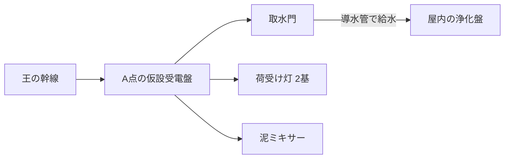

# 工区の受電と電力活用の拡張計画

## メタ情報

| 項目 | 値 |
| --- | --- |
| 計画ID | `power-reception-and-use-plan-2026-11-26` |
| ステータス | Draft |
| 作成日・最終更新日 | 2026-11-26 |
| 作成者 | Codex |
| 検討基点 | `c6326fba44c5824015c375d319aeda9251ab81ab`（自然換気・空調を含む作業ブランチ） |
| 関連計画 | [空調・導水計画](hvac-plumbing-plan-2026-07-13.md)・[第一工区ロードマップ](gameplay-roadmap-plan-2026-11-24.md) |
| 実装計画 | [初回案件のデータ設計、受電の成立条件、変更単位とテスト](power-reception-implementation-plan-2026-11-26.md) |
| 関連Issue/PR | 未起票 |

## 1. 受電は工事請負契約に定める

**各案件の受電条件は、入札要件とその案件で合意された工事計画を工事請負契約に反映し、受注時に確定する。** 契約書を開けば、どこで、どの方式・容量で、いつまでに、何を確認すれば「受電済み」になるかが分かる。施工者に任される範囲も案件ごとに示す。

川岸の工区を例に、初回の契約書を次の内容とする。地点・数値・時刻はゲーム内の例である。

| 契約書で受注前に示す項目 | この案件の条項 |
| --- | --- |
| 受電点・方式・容量 | 工区図のA点で王の幹線から仮設受電し、指定盤を使用する。外部電源の上限は2.0 W。地図では指定点と施工範囲を確認できる。 |
| 工程・分担 | 夜番開始の18時までに仮設受電。外部の引込み・供給開始は王の配電部門、構内の盤の施工と確認準備は所長の班が担当する。 |
| 受電の確認 | 指定の受電点・盤・容量を照合し、構内工事と供給側の引込準備が完了し、所長から準備完了の連絡を受けて幹線からその盤に電気が届いた時刻を記録する。ポンプの起動や荷受け灯の点灯は、その後の設備試験として別に記録する。 |
| 作業電源と終了条件 | 受電前の取水と施工中のミキサーにはSoul Spaを使用できる。灯の引渡試験は指定盤からの給電で行う。仮設供給は荷受け場の検収まで利用でき、検収後に使用終了と撤去を手配する。工事費・使用料の負担は受注時に示す。 |

所長が決めるのは、この条件に間に合うよう盤の資材を先に届けるか、どの班を据付へ回すか、開通待ちに何を施工するかである。据付後、所長が連絡するまでは「準備完了の連絡待ち」、連絡後も王側で引込準備が続く間は「外部供給待ち」と表示する。期限を過ぎて電気が届けば実績は「遅延受電」となる。**契約上の期限、供給側の予定、実際の受電時刻**を別々に表示する。供給側の予定変更だけで請負契約の条件を書き換えることはない。

受注後に指定点や容量を変えるには、工事計画・契約条件の正式な変更と、必要に応じて供給側の調整を経る。初回の案件は受注時の条件で完遂できる設計とし、条件変更の手続を遊ぶ機能は扱わない。

### 1.1 初回に建てるものと、所長の最初の五手

試作する現場は**「川辺の荷受け場に工事用の電気を引く」**一件。王の配電部門が仮設受電盤1面を貸与し、契約図のA点で現場渡しする。所長の班の工事は、台木を運び、架台と盤を据え、現場の受電準備が整ったことを配電部門へ連絡するところまで。下表の時刻と台木の数量は試遊用とする。

| 順 | 所長が見るもの・すること | 現場で起きること |
| --- | --- | --- |
| 1　16時に受注 | 契約書で「A点・仮設受電・上限2.0 W・期限18:00」、配電部門の引込準備予定17:30、供給終了は引渡し時と読む。「現地へ」でA点に寄る。 | A点に指定盤の輪郭が出る。受注時に貸与盤をA点で受け渡した記録が付き、木材2の架台と据付が所長の仕事になる。 |
| 2　盤を据え付ける | A点の「指定盤を施工」で設計図を置く。使い魔の担当範囲に資材と施工場所を含め、搬送・建築の優先度を決める。 | 木材が届くと表示が「台木 2/2」に変わり、Soulが通常の建築仕事で据え付ける。貸与盤の現場渡し、木材の実搬送、据付完了を個別に確認できる。 |
| 3　受電準備を連絡する | 盤の詳細で「指定点・盤仕様・据付」の照合結果を確認し、「準備完了を連絡」を一度押す。空いた班は床の補強に回せる。 | 配電部門の引込準備と現場の連絡がそろうと供給が始まる。たとえば王側が17:30に準備を終え、所長が17:42に連絡して指定盤で通電すれば、契約書に「受電 17:42／期限18:00」と残り、盤の表示器が点く。負荷は0 Wでもよい。 |
| 4　夜番を割り振る | 取水1.0 Wと荷受け灯2基の0.4 Wを優先する。残り0.6 Wで電動ミキサー0.8 Wを動かせない場合は、荷下ろし後に練るか、手の空いた班に手練りを任せる。 | 受電済みの盤で「給電中」と「順番待ち」の機器が分かる。選んだ工程に応じて泥の搬出と床の完成時刻が変わる。 |
| 5　翌朝に引き渡す | 指定床5マスの養生を終え、「試し点灯」で指定の2灯を確認する。 | 2灯に指定盤から同時に電気が届けば検収。受電時刻、引渡時刻、工費、手当を精算書に並べる。仮設の供給を終了し、班が盤を撤去する。 |

受電後の電気と水の行き先は次のとおり。ゲーム内の系統図には運転中の回路と現在の供給元を表示する。

**工区図の用地** 試遊では同じYard内にA点1マス、灯2基の各1マス、ミキサーを取り、屋外床は連続する1×5マスとする。灯は床の脇に置き、猫車が床工事の資材置場へ入る通路を確保する。河岸の取水門は対のSiteからこのYardに接続し、地下管の先に稼働中の屋内浄化盤がある。通常ワールドでは契約提示時に初期工区の位置を基準に、配置・電源の所属・通路・既設の通水を照合する。適地が塞がっていれば地図に理由を出す。受注時に対象を固定し、以後の障害は同じ場所で解消する。[ワールドの基準点](../../crates/hw_world/src/anchor.rs)・[設備の設置条件](../indoor_air.md)・[工区と電力網の対応](../../crates/bevy_app/src/systems/energy/grid_lifecycle.rs)

**持ち込む資材** 貸与盤1面は受注時にA点へ現場渡しする案件備品として記録し、搬送可能な共通資源に追加するのは見送る。所長が手配する分は台木2、床用の骨10と泥5、灯2基用の骨4。泥5は既設ミキサーで砂・岩・水各1から一釜作れる。準備済みセーブでも台木と骨は搬入前、泥は製造前に置き、実際の仕事を通す。[建物ごとの必要資材](../../crates/hw_jobs/src/model.rs)・[床施工](../building.md)・[一釜分の精製](../../crates/hw_soul_ai/src/soul_ai/execute/task_execution/refine.rs)

## 2. 受電後の電力を使う依頼「川辺の夜普請」

> **王の工事依頼**　夕方六時までに、工区図のA点で幹線から電気を受けよ。朝番の猫車が来るまでに、川沿いに五マスの荷受け場を造り、その電気で二つの灯をともせ。隣の浄化盤への給水を守り、夜荷が来たときに灯の下で受け取れたら、手当を弾もう。

契約には「18時までに指定盤で受電」と「翌朝6時までに荷受け場を引き渡す」の二つの節目がある。所長は先に受電を成立させ、その先で使い魔の班を動かし、完成した荷受け場の灯を確かめる。繰り返す操作は **現場を見る → 次に重なる仕事を予測する → 班か電源の方針を一つ変える → 地図で結果を見る**。個々のSoulへの指示は使い魔が担う。

| 任務のルール | 試作での扱い |
| --- | --- |
| 舞台 | 初期Yardと対のSiteにある、稼働中の川岸の取水門・導水管・浄化盤を使う。隣に床を新設できる5マスと、屋外ランプ2基の指定位置がある。工区は地図で確認できる。 |
| 引渡し | 指定の5マスがすべて養生を終えた後、所長が「試し点灯」を押す。対象の2灯が同じ仮設受電盤から実際に同時給電されれば検収。すでに点灯中ならその場で確認できる。完成前の点灯記録や別の場所の床は進捗に数えない。 |
| 納期と報酬 | 試遊値は完工 **20 Dream**、朝番までの検収 **＋10**、約束どおりの給水・夜間荷受け **＋5**。受電期限は工程実績として記録する。この案件の納期加算は引渡しの検収時刻で決まる。手当と費用条件は受注前に開示する。遅れても同じ工事を仕上げて基本報酬を受け取れる。 |
| 持ち帰るもの | 床・灯・既設の水路は同じワールドに残る。この案件の終了条項に従って仮設供給を終了し、盤を撤去する。次の工事で使う設備と受電条件は次の契約書で示す。 |

初回試遊は**夕方16時開始、翌朝6時が納期**の準備済みセーブを使う。班、運転中のSoul Spa、泥ミキサー、猫車、契約に定めた初期費用をまかなえる共有Dreamを用意する。等速で納期までは実時間14分、4倍速なら3分30秒。これはゲーム時計の換算で、読んで考える時間・一時停止・実際の完工時間は試遊で別に測る。通常のワールドでは同じ設備がそろえば既設物を利用できる。受注画面で次の夜番（18時〜翌6時）と締切の日時を示し、準備や早期引渡しはいつでも進められる。この勤務帯は依頼と点灯予約の新ルールで、時計で判定する。先行する「第一工区の給水所」のバケツ給水だけでは、浄化盤への通水条件は満たさない。[既存の契約・地図ToDo](../ui-world-first.md)・[ゲーム時計](../../crates/bevy_app/src/systems/time.rs)・[空調・導水計画](hvac-plumbing-plan-2026-07-13.md)

## 3. 契約書・盤・地図での操作

- **契約書**で受電条件、請負側の工費、配電部門の予定、受電と引渡しの期限を読む。「現地へ」でA点に寄り、「指定盤を施工」で設計図を置く。地図に出す依頼は一つ選べる。受注後は契約書に実受電時刻と検収時刻が加わる。
- **盤の詳細**で次の一手を選ぶ。「台木 1/2・搬送待ち」なら「仕事を確認」から搬送の状況と担当の使い魔を確認する。「指定点・盤仕様・据付 照合済み」なら「準備完了を連絡」を押せる。連絡後は王側・現場側のどちらを待っているかが残る。受電後は同じ場所で取水・灯・攪拌の運転方針と使用量を確認する。
- **地図**では既存の「建てる」、使い魔の担当範囲と作業方針、ポーズ、速度変更を使う。供給を待つ間も、所長は荷受け場の床と灯の施工を進められる。夜荷は通常の搬送で到着し、盤を毎回操作しなくても予約した方針に従う。[地図と共通パネル](../ui-world-first.md)・[仕事一覧](../task_list_ui.md)・[発電担当の作業枠](../soul_energy.md)

## 4. 契約容量の中で仕事を回す

受電盤を選ぶと、たとえば次の一枚を見る。これは試遊用の表示例で、到着前の材料は在庫に数えない。

> **夜番の受電盤　契約図A点・指定容量2.0 W・受電済み**
>
> 取水中 1.0 W　・　荷受け灯2基 点灯中 0.4 W　・　空き 0.6 W
>
> 次の仕事　泥をひと釜練る。材料は到着済み。電動にはあと0.2 W必要。
>
> 現在の方針　空きができたら電動　　変更先　人力で練る ／ 攪拌をSoul Spaへ

| 所長の読み | 選択と代償 |
| --- | --- |
| 昼に材料がそろいそう | 取水を維持しながら、灯が消えている昼に攪拌を先行させる。合計1.8 Wは指定容量に収まる。夜にずれ込んだら既定方針で待つか、人力で一釜練る。手練りに割いたSoulは、その間ほかの仕事に就けない。 |
| 砂を運ぶ猫車が遅く、夜に施工班が空く | 荷受け中は取水と2灯に1.4 Wを確保する。攪拌を重ねると2.2 Wになり、0.2 W超過する。荷下ろしが終わって2灯を休められる時間へ攪拌を移すか、人力で進める。 |
| 夜荷の処理と並行して電動で練りたい | **攪拌回路だけをSoul Spaへ**。実働1体の1.0 Wから0.8 Wを使い、取水と2灯は外部の1.4 Wで継続する。実働者がいなければ「発電担当待ち」を出し、手練りに切り替えられる。この回路の仮運転は契約で許されており、外部からの受電実績には含めない。 |
| 手当より今の工事を早く終えたい | 荷役中も灯を一時消す、または取水を計画停止することもできる。どの手当を逃し得るかを操作前に表示する。夜の荷役が終わってから灯を休めて攪拌するのも有効な工程の組み方。 |

**手当は現場の結果で判定する。** 品質手当＋5の条件は、受注から検収まで指定の稼働済み浄化盤が実際に通水・排泥を継続し、夜番中に指定床工事の資材置場で荷を実際に降ろしたときは、その都度、対象2灯が点いていたこと。試作では猫車から資材を降ろす処理が成功した時点で判定し、通過・中断した便は含めない。昼にすべて搬入できれば夜間点灯の条件は発生しない。灯の運転予約は既定で自動。手当を失うのは実際に断水・消灯荷役が起きたときで、一度失っても納期手当と完工報酬は取れる。締切を過ぎても引込工事・床・支払済み費用は引き継ぎ、工区をやり直さずに完成させられる。

取水門1.0 W・灯1基0.2 Wは作業版の値。攪拌0.8 W・本案件の指定容量2.0 W・報酬は試遊用の値。現行ランプの回復効果は照らされた室内にある。屋外の工事に暗所ペナルティは足さず、夜番の点灯には依頼主が対価を払う。計量は外部電源で実際に供給した分だけを時間で積算し、現場発電は実働Soulとその個人Dreamを使う。詳細見積では引込・撤去の一時費用、固定費、使用料を確認できる。[配電規則](../../crates/hw_energy/src/allocation.rs)・[室内照明の効果](../indoor_lighting.md)・[Dreamの用途](../dream.md)

## 5. 段階的に増やす遊び

| 段階 | 届ける体験 | 次へ進む判断 |
| --- | --- | --- |
| **M1　最初の通電** | 夜普請の前半を内部試作する。契約図から指定点へ移動し、指定盤の据付、準備完了の連絡、外部からの受電確認までを遊べる。 | 指定盤での外部受電が成立した時点でM1達成。灯やポンプがまだ停止中でもよい。別の盤への通電、Soul Spa単独の給電、盤の完成だけでは未達となる。 |
| **M2　一晩を最後まで遊ぶ** | M1に運転方針、電動と人力の選択、床の検収、報酬と工費の精算をつなぐ。**最初のプレイヤー向け版はM1＋M2**。受電済みの工区では、契約が認める用途・期間内で配電方針を変更できる。 | 同じ設備で昼着材・夜着材を試す。受電条件を固定したまま、施工順や人員の割振りで完工時刻が変わる場面を確かめる。 |
| **M3　次の依頼「機械室を引き渡せ」** | 同じ敷地に機械室を増築。新しい請負契約に記載された本設受電点、容量、受電期限、引渡試験を確認する。工事用電源で残工事を進め、本設の指定盤で受電を確認した後に取水と送風を単体試運転する。最後は同時に動かして実性能を証明する。 | 指定機器が本設側から実際に給電され、対象室の排泥と必要外気量を連続30ゲーム分（試遊値）維持して引渡し。断水なら管、通電しても風が届かなければ通風経路を現地で直せる。中断後は試験時間だけを取り直し、完成設備は残る。 |

任務を繰り返して報酬を稼ぐ仕組みは加えず、前の現場で覚えた工程の読み方や配電方針を、条件の異なる次の請負工事でも生かせるようにする。将来は高圧受電を指定する案件で、受変電設備の調達や搬入の段取りを扱える。

### 5.1 アセットの制作表

| 対象・点数 | 制作するもの／流用元 | ゲーム画面での採用条件 |
| --- | --- | --- |
| **仮設受電盤 1種・1面（M1）** | 新作。1×1マスの台木に載る背の低い錆鉄の盤、上から読める表示器、引込側の端子を一つの原本にまとめる。本体と表示器を別部品とし、未受電と通電で同じ形を使う。初回は箱形の仮モデルで据付と給電を通し、完成原本から現場モデル・配置見本・契約カード用の小図を作る。 | 通常距離で灯やタンクと区別できる。契約図の輪郭、施工中の進捗、完成した盤、表示器の点灯が同じ位置を指す。遠景・夜は記号と詳細文でも状態を読める。供給停止時は表示器が消え、初回受電の時刻は残る。 |
| **工区図の表示 1組（M1→M2）** | 既存の工区枠を拡張。M1は「A」のピン、王側引込端、両者を結ぶ予定の破線／通電時の実線。M2は指定床5マスの帯と同じ灯記号2個を加える。線は供給状態から描画する。 | 契約を切り替えると選択中の工区だけが強調される。引込の線は人や資材の通行を塞がず、供給終了で消える。A点と灯を色に頼らず識別できる。[現行の工区表示](../../crates/bevy_app/src/interface/ui/waterworks.rs) |
| **貸与品と施工の表示（M1）** | 現場渡しはA点の「貸与盤1面・受領済み」で示す。木材の荷姿、搬送するSoul、設計図の骨組み、施工進捗は既存表示。受電盤の箱や電線を運ぶ専用キャラクター・資源画像の制作は初回の見積に含めない。 | 現場を選べば「貸与品受領」「台木 0/2〜2/2」「据付済み」を識別できる。通常取消から同じ貸与盤で施工を再開できる。 |
| **運転設備と床（M2）** | 屋外ランプ1種を2基、泥ミキサー・Soul Spaを各1基流用する。ミキサーは既存ドラムの回転を電動の一釜の進捗にも接続。床の補強・打設・養生、猫車と荷役も既存表示を使う。 | 灯は実点灯時に光り、材料待ちや給電待ちのドラムは止まる。盤の表示器と荷受け灯を別々に観察できる。[採用済みの建物セット](../../crates/bevy_app/src/assets/building_asset_set/default_release_bindings.json)・[床の表示](../../crates/hw_visual/src/floor_construction.rs) |
| **水路・機械室（M2→M3）** | 取水門・導水管・浄化盤は現行の画像と設備記号を使う。M3の初期試作は既存の送風機と、仮設盤を基に外形・銘板を変えた本設盤1種を予定する。 | M2では指定した浄化盤の通水を確認できる。M3では地図で仮設盤・本設盤を区別し、機械室の送風と排泥の試験結果を読める。[設備記号](../../crates/hw_jobs/src/equipment.rs)・[設備画像の割当](../../crates/bevy_app/src/assets.rs) |

美術の着手順は、A点のピンと仮モデルでM1を操作できるようにしてから、採用する寸法で盤を仕上げる。納品物は編集用原本、実行用のモデルと表示器材質、同じ原本から作る小図、草地・土での通常距離／遠景と夜の比較画像。原本は外部staging、採用した実行資産は既存の建物アセットセットの導入手順で扱う。[建物の美術方針](../building-art-direction.md)・[建物セット](../building-asset-sets.md)・[アセット原本と配布物](../assets_workflow.md)

### 5.2 機能の実装順と引渡物

| 順序・担当領域 | 既存機能を使う箇所と追加する処理 | 次の工程に渡せる状態 |
| --- | --- | --- |
| **① 契約図と契約書（M1）** | 初期Yardの基準点から適地を調べ、受注前に確定案を表示する。契約ごとに指定点・指定盤仕様・容量・絶対日時の期限・供給側の準備予定・費用負担・許容電源を持つ。給水所専用の管理枠とToDoを、選択中の案件を切り替えられるよう拡張する。 | 「管理 → 契約」で給水所と夜普請を見比べられる。受注時の契約条件を保存し、地図を閉じても工事は進む。期限を過ぎた案件は同じ日付のまま続く。[契約の状態と受領](../../crates/bevy_app/src/systems/waterworks.rs)・[現行の契約画面](../../crates/hw_ui/src/waterworks.rs) |
| **② 盤の施工と対象の引継ぎ（M1、①の後）** | 「指定盤を施工」はA点のみ確定できる。設備種に仮設盤を加え、既存の設計図、木材の配送、建築仕事を使う。竣工時に案件と設計図の指名を完成盤へ移す。仕事の詳細へ移る導線を加え、搬送・建築の指示は使い魔の既存方針を使う。 | 木材が足りなければ不足数が出る。取消・再配置後も貸与は1面。別工区の同型盤や解体した盤への供給は成立しない。[設計図への搬送](../../crates/hw_logistics/src/transport_request/producer/blueprint.rs)・[竣工処理](../../crates/bevy_app/src/systems/jobs/building_completion/mod.rs) |
| **③ 配電部門の引込みと受電記録（M1、①②の後）** | 供給側はゲーム時計で「手配済み→引込準備完了」と進む。現場は竣工した盤と契約図を照合した後、「準備完了を連絡」で案件・盤を指定して通知する。両者がそろえば供給側がその盤に通電する。連絡後に盤を撤去した場合は連絡を失効させ、据付後にもう一度確認する。受電点・盤・容量・供給元の一致を検証し、最初の実受電時刻を一度だけ記録する。現在の活線状態と過去の実績を別に持つ。 | 現場が先なら「外部供給待ち」、王側が先なら「台木不足」「据付待ち」「準備完了の連絡待ち」の該当段階。両方そろうまで実績は空欄。予定時刻だけ進めても受電にならない。ここで全負荷を止めたままM1を試遊できる。[ゲーム時計](../../crates/bevy_app/src/systems/time.rs)・[既存の配電状態](../../crates/hw_energy/src/components.rs) |
| **④ 回路別の給電と夜番（M2、③の後）** | 現行の1 Yard・1電力網は発電出力を合計する。案件回路に「指定盤／許可された自家発電」の供給元を持たせ、各需要を一方へ割り当て、供給元ごとに既存の配電規則を適用する。案件の「順番待ち」は予算に収まるまで攪拌の始動要求を保留し、一括配電を使う設定でも運転中の取水と灯を守る。給電結果に実際の供給元と供給Wを持つ。盤の詳細には現在の余力、次の攪拌に不足するW、待機理由と方針を表示する。 | 2.0 Wの指定盤で取水と2灯に1.4 Wを供給し、0.8 Wの攪拌は待つ。攪拌を稼働中のSpaに移せば両方が動き、指定盤には1.4 Wの実負荷を表示し、1ゲーム時間維持すれば計量値は1.4 Wh増える。案件外の消費先は従来の電力網で動く。[現行の集計](../../crates/bevy_app/src/systems/energy/grid_recalc.rs)・[配電関数](../../crates/hw_energy/src/allocation.rs) |
| **⑤ 現場作業と引渡試験（M2、④の後）** | 人力・電動で一釜の材料と出来高を共有する。指定5マスは対応する床工事の養生後の竣工で数える。夜荷はその床工事の資材置場への実荷下ろしに紐づける。浄化盤ごとの通水・排泥を読む。試し点灯は2灯に点灯要求を出し、同一の配電結果で2灯に指定盤から正の電力が届いたら合格とする。 | 荷物が近くを通るだけでは手当の判定は動かない。他室の排泥、昼の古い点灯、Spaからの点灯は引渡試験に流用できない。床に泥を使い切った時点でも、養生前なら「床を養生中」と出る。[荷下ろし処理](../../crates/hw_soul_ai/src/soul_ai/execute/task_execution/haul_with_wheelbarrow/phases/unloading.rs)・[床の竣工](../../crates/bevy_app/src/systems/jobs/floor_construction/completion.rs)・[設備の通水判定](../../crates/bevy_app/src/systems/ventilation/climate.rs) |
| **⑥ 計量・精算・撤去（M2、③〜⑤に接続）** | 請負側負担の引込・撤去・固定費を受注前に掲示する。外部使用量は実供給W×ゲーム内の経過時間で積算し、検収時に計量を締め、工費と報酬を別明細にする。検収後は外部給電を切り、既存の解体仕事に貸与盤の返却を結ぶ。保存対象に条項、初回受電時刻、計量の途中値、引渡実績、支払・返却状態を加える。 | 受注二度押し、受領二度押し、受電前・夜間・検収直後の再開で、二重請求・二重受領・盤の二重貸与がない。撤去後も床・灯・既設給水所の記録は残る。[保存スキーマ](../../crates/bevy_app/src/systems/save/schema.rs)・[ロード時の電力網](../../crates/bevy_app/src/systems/save/rehydrate/candidate/topology/energy.rs) |

最初のプレイヤー向け版は①〜⑥。試遊用の依頼データ1件、16時の準備済みセーブ1件、現行の給水所も受注できる通常生成ワールドを用意する。①〜③が遊べる時点で、盤が完成したのに受電待ちである理由を画面から説明し、必要な操作に移れるかを先に試す。M3の本設盤、機械室の送風・排泥を30ゲーム分維持する引渡試験は、この一件を精算まで通した後に着手する。

## 6. 試遊で確かめること

| 試遊ケース | 合格とする画面・記録 |
| --- | --- |
| 王側が先に準備完了。18:00ちょうどに現場が連絡／18:01に連絡 | 実際に通電した時刻が18:00なら期限内、18:01なら遅延。同じ工事を続行できる。未連絡や別の盤では実績が空欄。 |
| 盤に電気が届き、全負荷が停止。続いて2灯を点灯し、荷下ろし中に攪拌を要求 | 受電実績は負荷0 Wで記録される。取水と灯で残り0.6 Wなら攪拌は待機。人力へ変更すれば電気を使わずに同じ一釜が進む。 |
| 給水所と同時進行し、夜普請の検収直前に保存・再開 | 地図は選択案件を指す。指定盤に通じる2灯と養生済みの5マスで夜普請だけが検収され、精算・返却は各1回。夜普請の記録がない旧セーブは、従来の給水所の実績と配電を維持する。 |

- **操作を教えずに一晩を任せる。** 受注前に何を建てればよいか、夜荷の到着時に何が足りず何を優先するか、引渡し後にどの判断が支出・納期を変えたかを本人の説明と操作から確認する。式を読まなくても「水と灯りは動くがミキサーを待たせた」と分かることを目標にする。
- **同じ現場を分岐して比べる。** 初期時刻・人員・工区・在庫・途中の搬送をそろえたセーブから施工案を選ぶ。材料到着、泥の搬出、5マスの養生完了時刻、断水・消灯荷役、発電担当の累計時間、共有Dreamの差引を記録する。昼着材と夜着材は通常の搬送で成立した別の開始条件を使う。準備済みセーブの比較とは別に、通常ワールドから依頼を発見して必要設備をそろえる経路も試す。
- **人力という近道も試す。** 既存の一釜は砂・岩・水各1から泥5を作り、着任後の攪拌は約2仮想秒。床5マスには骨10と泥5が要る。電動は材料搬入・取り出しを人が担い、攪拌中だけ担当者の手を離せる案とする。一釜のために発電担当を立てるより手練りが早ければ、その結果を認める。夜普請には人力を残し、電動運転の本格導入は複数バッチが必要な増築で改めて比べる。[精製の実装](../../crates/hw_soul_ai/src/soul_ai/execute/task_execution/refine.rs)・[床施工と養生](../building.md)・[搬送](../logistics.md)
- **詰まりに気づいて戻れるか。** 材料未着、手練り担当不在、外部供給待ち、搬出待ち、導水管の欠損を一つずつ起こす。表示は原因のある設備・仕事へ案内する。停電のたびに盤を操作しなくても、同じ方針で復旧することを確認する。停止・4倍速・保存再開後も締切、判定済みの手当、精算結果、試験時計を一致させる。

## 7. 現実の工事から残したルールと実装境界

日本下水道事業団が示す、工程に合わせた負荷見積と商用電源・現場発電の選択を「夜のひと釜」に置き換えた。現場側の盤が完成しても供給側の工事と確認を待つこと、工区の使用終了と仮設撤去が別の節目であることを地図に残す。須賀川地方衛生センターで受電後に実負荷試運転・引渡性能試験へ進んだ流れは、次の依頼の手本とする。[日本下水道事業団の仮設電力計画](https://www.jswa.go.jp/nyusatsu/youshiki/pdf/D11.pdf)・[東京電力PGの新設手順](https://www.tepco.co.jp/pg/consignment/workshop/procedure/low-pressure/new-changes.html)・[施工監理者による須賀川の記録](https://www.yachiyo-eng.co.jp/case/TT04002/)

- **接続と給電。** 一組のSite・Yard内で各回路が使える電源は請負契約と工事計画に従う。外部受電の取り決めがない工区は既存の自家発電で動く。取水門の対応Yardを照合し、浄化盤への通水とミキサーへのバケツ搬送を独立に扱う。既知の遮断負荷の復帰余裕0.05 Wと、従来の一括配電設定も検証する。[電力仕様](../soul_energy.md)・[接続判定](../../crates/bevy_app/src/systems/energy/grid_lifecycle.rs)
- **世界の状態で判定する。** 受注時に確定した受電条件、実際の受電時刻、設備の試験結果を別々に保存する。保存・再開後も同じ契約条項で判定する。費用と設備・床・試験の対象は工区とワールドに紐づける。人力と電動の切替で一釜分の材料を一度だけ消費する。建て直し・取消・ロード失敗後の復旧でも、未完の床、古い点灯、別工区の排泥を数えない。検収時の報酬と費用内訳を確定し、受領は一度。受注以前の設備や希望時刻をそのまま完工記録へ転記しない。[保存仕様](../save_load.md)
- **引継ぎ。** 全段階が設計案。まず対象床5マスが新設可能で、導水が実際に機能し、猫車で資材が届く試遊場所を通常の生成・施工経路で確認する。M1は指定盤の受電だけを検証できる。M2の通水手当とM3の引渡しは空調・導水設備の実状態から検証する。実装段階でHelp、変更別CI、実画面の受入、検証ストレージを各段階に合わせて確認する。[開発手順](../DEVELOPMENT.md)・[検証データ管理](../development-infra/validation-storage-workflow.md)

## 更新履歴

| 日付 | 変更者 | 内容 |
| --- | --- | --- |
| 2026-11-26 | Codex | 初期工区の受電・電動精製・蓄電・工区間送電の候補を起案。 |
| 2026-11-26 | Codex | 日本の仮設電力計画、低圧引込み、実施設の受電・試運転をもとに改訂。工区増築の工程、負荷表、電源の使い分けと引渡条件を具体化。 |
| 2026-11-26 | Codex | 夜普請の一晩を、受注・現地の方針選択・試し点灯・精算まで遊べる任務として設計。手練り、消灯荷役、遅延引渡しを含む試遊条件を追加。 |
| 2026-11-26 | Codex | 受電条件を入札要件・工事計画に基づく請負契約の条項として確定。受電の工程実績と、受電後の配電・試運転・引渡しを個別に判定する内容へ改訂。 |
| 2026-11-26 | Codex | 指定盤1面を貸与する初回案件の現場図・資材表、受電準備連絡、制作アセット、実装順①〜⑥、受電・配電・引渡しの受入ケースを具体化。 |
